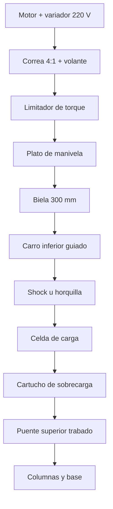

# Banco de amortiguadores — Plan mecánico

Sep 24, 2026 · @Eric

## Concepto de producto

El banco es una máquina de taller compacta que ensaya un shock o una horquilla completa con un solo montaje y en pocos minutos. Es independiente de Sender: tiene su propio controlador, su pantalla táctil y su software, y no necesita una PC. Se vende sola o en combo, y comparte el formato de datos con Sender y SendFlow.

| Producto | Dónde trabaja | Qué mide |
| --- | --- | --- |
| Sender (campo) | En la bici, en pista | Cómo trabaja la suspensión con ese piloto |
| Banco (taller) | En el taller | Qué hace el shock o la horquilla en sí |
| Combo | Ambos | Curva del banco superpuesta al histograma real de velocidades del piloto |

Ensayos, todos en la misma secuencia automática:

| Ensayo | Resultado |
| --- | --- |
| Curva de resorte | Fuerza–posición en todo el recorrido: presión, tokens, progresividad |
| Curvas de amortiguación | Fuerza–velocidad en compresión y rebote, también según la posición en el recorrido |
| Fricción y breakaway | Fuerza de arranque de sellos y bujes |
| Cavitación / purgado | Lazo fuerza–posición deformado en la inversión = aire en el aceite |
| Mapa de clicks (opcional) | Familia de curvas por posición de ajuste |
| Fade térmico (opcional) | Pérdida de fuerza con la temperatura |

Principios de diseño: máquina autónoma con pantalla propia, tamaño compacto, alimentación 220 V monofásica, un solo seteo por shock y juego mecánico cero. Nombre comercial pendiente, siguiendo la identidad de Sender y SendFlow.

## Especificaciones

El banco ensaya shocks de 40 a 75 mm de carrera y horquillas completas de hasta 605 mm de eje a corona (Fox 40, Boxxer) en todo su recorrido, con un solo montaje y una estructura calculada para 10 kN.

| Parámetro | Objetivo | Nota |
| --- | --- | --- |
| Carrera de ensayo | De 40 a 200 mm, por posiciones fijas del plato | Recorrido completo de shocks (40–75 mm) y horquillas (hasta 200 mm), con 2 mm de margen por lado |
| Velocidad en shocks | ≈ 1,5 m/s en todas las carreras | A confirmar con el percentil 99 medido con Sender |
| Velocidad en horquillas | ≈ 2 m/s en recorrido completo | Depende de la fuerza de la horquilla |
| Frecuencia | 0,1 a 13 Hz | Carreras largas trabajan a menos frecuencia |
| Fuerza de medición | ±10 kN, una sola celda | Cubre shocks cerca del fondo y horquillas |
| Estructura | 10 kN de diseño | Protección de sobrecarga a ≈ 8 kN |
| Largo entre montajes | 150 a 280 mm (shocks); hasta ≈ 700 mm (horquillas, eje a tubo de dirección) | Metric, imperial, trunnion; simple y doble corona |
| Luz entre columnas | 340 mm entre centros (≈ 300 mm libres) | Pasan coronas y botellas de horquillas de 20 × 110 |
| Juego en la inversión | < 0,02 mm | Evita picos falsos en la curva |
| Repetibilidad | ±2 % entre corridas con desmontaje | Lo que necesita un antes/después |
| Alimentación | 220 V monofásica | Variador de entrada monofásica, motor trifásico |
| Tamaño | ≈ 550 × 450 mm de base, ≈ 1,6 m de alto | De piso, con la base como soporte |
| Peso | ≈ 150 a 190 kg |  |
| Tiempo de ensayo | Seteo < 3 min, secuencia automática de pocos minutos | Un solo montaje |

## Arquitectura y dimensiones

La máquina tiene la configuración de los dinamómetros de competición: dos columnas-guía, un puente superior que se corre a mano y se traba, y abajo la biela que mueve un carro guiado. Mide ≈ 1,6 m de alto, determinado por la horquilla más larga (605 mm de eje a corona) y por la carrera de 200 mm.

&#91;image: Esquema del banco con shock y con horquilla de doble corona\]

Esquema frontal, sin escala. Naranja: lo que se mueve. Verde agua: lo que mide. Ámbar: las trabas que se aprietan a mano. El motor va detrás de la base; está dibujado al costado para que se vea la correa.



Alturas aproximadas desde el piso:

| Zona | Altura (mm) | Qué hay |
| --- | --- | --- |
| Base | 0 a 300 | Cigüeñal y plato Ø 260; motor detrás |
| Carro inferior | ≈ 580 en el punto más alto | Biela de 300 mm, recorrido de hasta 200 mm |
| Zona de ensayo | 600 a 1.300 | Shock (150–280 mm) u horquilla (hasta ≈ 700 mm con el tubo de dirección) |
| Celda y sobrecarga | ≈ 180 mm sobre el ojo o la dirección |  |
| Puente | Variable, ≈ 500 mm de recorrido | Se corre a mano, dos trabas |
| Travesaño | ≈ 1.600 | Une las columnas; sostiene los resortes a gas |

Decisiones clave:

- **Celda en el puente (lado fijo):** no mide fuerzas de inercia del carro.
- **Posición medida en el ensayo:** la velocidad sale de la posición real, no de las rpm.
- **Un solo par de columnas:** guían el carro y el puente.
- **La altura la definen la horquilla y la carrera:** una versión solo para shocks, con columnas y biela cortas, quedaría en ≈ 1,1 m.

## Accionamiento

Una sola biela de 300 mm sirve para todo, desde un shock de 40 mm hasta una horquilla de 200 mm. Lo que cambia con la carrera es la posición del perno en un plato más grande, y el motor necesita más torque para las carreras largas.

### Por qué alcanza una sola biela

- La biela solo tiene que ser bastante más larga que el radio de manivela. Con 300 mm y el radio máximo de 98 mm (horquilla de 200), la relación es ≈ 1/3.
- Esa inclinación genera una fuerza lateral de ≈ 35 % de la fuerza de ensayo. La absorben los bujes del carro sobre las columnas; el shock o la horquilla solo reciben carga axial.
- El movimiento deja de ser una senoide pura, pero no importa: la velocidad se calcula con la posición medida, no con las rpm.
- En shocks cortos la biela larga trabaja casi recta, que es lo ideal.

### Plato de manivela

- Acero 4140 bonificado, Ø 260 × 35 mm.
- Un agujero escariado H7 por cada carrera estándar, en dos espirales para que entren todos:

| Uso | Carreras nominales (mm) | Radio del perno (mm) |
| --- | --- | --- |
| Shocks | 40 · 42,5 · 45 · 47,5 · 50 · 52,5 · 55 · 57,5 · 60 · 62,5 · 65 · 70 · 75 | 18 a 35,5 |
| Horquillas | 100 · 120 · 130 · 140 · 150 · 160 · 170 · 180 · 190 · 200 | 48 a 98 |

- Cada agujero da la carrera nominal menos 4 mm (2 mm de margen por lado), para no llegar nunca a tope.
- Posiciones grabadas; un sensor detecta en qué agujero está el perno y el ensayo no arranca si no coincide con el modelo elegido.
- Si en el CAD no entran los 23 agujeros con buena pared entre ellos, la alternativa son dos platos intercambiables (shocks y horquillas) en el mismo cubo.

### Perno de cambio rápido

- Ø 20 mm templado y rectificado, asiento cónico y traba de palanca: sin juego y sin herramientas.
- Cambio de posición en menos de un minuto, como parte del seteo.

### Biela y carro

- Biela de aluminio 7075-T6, 300 mm entre centros, rodamientos de agujas o rodillos cónicos en ambos extremos. Sin rótulas.
- Carro de acero de 25 mm con bujes de bolas precargados de 80 mm de largo, para soportar la fuerza lateral de la biela sin juego.

### Motor, variador y transmisión

| Componente | Especificación |
| --- | --- |
| Motor | Trifásico 4 kW, 4 polos, en triángulo (3 × 220 V), detrás de la base |
| Variador | Vectorial, entrada 1 × 220 V, salida 3 × 220 V, hasta ≈ 110 Hz, con resistencia de frenado |
| Transmisión | Correa dentada HTD 8M, relación 4:1 |
| Cigüeñal | Hasta ≈ 800 rpm (motor ≈ 3.200 rpm a 107 Hz) |
| Torque en el cigüeñal | ≈ 156 N·m a baja velocidad (motor con 150 % de sobrecarga) |
| Encoder | Magnético absoluto en el cigüeñal |

- Las carreras largas piden torque y pocas rpm; los shocks cortos piden rpm y poco torque. La relación 4:1 con el variador trabajando por encima de 50 Hz cubre los dos extremos sin cambiar la correa.
- Hay que confirmar con el fabricante del motor que admite ≈ 3.200 rpm.

### Volante y contrapeso

- Volante de ≈ 10 kg en la polea del motor: gira 4 veces más rápido que el cigüeñal, así que guarda energía con poco peso.
- Contrapeso en el plato para la masa rotante. Como el perno cambia de radio, el contrapeso se calcula para la posición de horquilla más usada.

### Protecciones mecánicas

- **Limitador de torque** en el cubo de la polea del cigüeñal, regulado a ≈ 180 N·m.
- **Cartucho de sobrecarga** entre la celda y el puente: resortes de disco precargados a ≈ 8 kN, con fin de carrera que corta el variador. Cubre el punto muerto, donde la biela multiplica la fuerza.
- **Verificación por software** antes de cada ensayo: un ciclo lento confirma que la carrera entra en el recorrido libre.

## Estructura

Dos columnas Ø 40 mm guían el carro y el puente. El puente se corre a mano unos 500 mm, para pasar de un shock corto a una horquilla de DH, y dos trabas lo fijan con más del doble de la fuerza máxima.

### Columnas

- Acero SAE 1045 cromado duro, Ø 40 × ≈ 1.350 mm, a 340 mm entre centros (≈ 300 mm libres). Pasan las coronas y las botellas de una horquilla 20 × 110.
- Abajo: asiento rectificado y tuerca contra la placa de la base. Arriba: travesaño de 25 mm que las mantiene paralelas.
- Paralelismo y perpendicularidad a la base < 0,05 mm en toda la altura, para que el puente corra perpendicular.
- Con 1,35 m de largo hay que verificar en el CAD la flexión lateral por la fuerza de la biela. Si hace falta, se pasa a Ø 50 mm.

### Puente superior

- Placa de acero 50 × 120 × 420 mm con un buje de bolas por columna, para que corra suave y siempre perpendicular.
- Dos trabas partidas, una por columna, con zapatas de bronce y tornillo M16 con manija. Cada una sostiene ≈ 12 kN.
- Dos resortes a gas desde el travesaño compensan el peso del puente con la celda (≈ 10 kg): se mueve con una mano y no cae al soltar las trabas.
- Regla grabada en una columna para ubicar el puente según el largo que indica el software, sea de shock o de horquilla.

### Base

- Caja de chapa plegada de 4 mm reforzada con tubo 80 × 80, 550 × 450 × 300 mm. Es un poco más grande que en la versión solo shocks, por el plato de Ø 260 mm.
- Placa superior de 25 mm, planeada después de soldar.
- Máquina de piso: patas niveladoras y agujeros para anclarla. Con 1,6 m de alto conviene anclarla o darle una base ancha, para que no cabecee con la vibración.
- Tapas laterales con interruptor de seguridad para acceder a la correa y al plato.
- Cajón lateral para los kits de adaptadores.

### Rigidez

- El lazo de fuerza cede algo a 10 kN. El sensor de posición mide directo entre el carro y el puente, y el software compensa la rigidez medida en la calibración con un eslabón rígido.

## Montaje y flujo de uso

Sea shock u horquilla, se monta una sola vez: perno de manivela, adaptador de abajo, puente, adaptador de arriba y dos trabas. Después todo el ensayo es automático.

### Montajes de shock

- **Arriba:** puente → cartucho de sobrecarga → celda de carga 10 kN (tracción–compresión, apta fatiga) → horquilla superior → ojo del shock.
- **Abajo:** carro → horquilla inferior de aluminio → ojo del shock.
- Horquillas en U con perno Ø 8 mm h6 y separadores templados que se aprietan contra el buje: sin juego.
- Kit base Fox y RockShox; kit de ampliación Öhlins y EXT. Adaptador trunnion con insertos intercambiables.
- Sin rótulas en ningún montaje.

### Medición de posición

- Sensor lineal sin contacto (encoder magnético, 1 µm o mejor) de 250 mm de recorrido entre el carro y el puente, protegido con fuelle. Cubre desde el shock más corto hasta la horquilla de 200 mm.

### Flujo de uso

1. En la pantalla del banco se elige marca y modelo, o se cargan recorrido y largo.
2. El software indica el agujero del plato y deja la biela en posición de montaje.
3. Se coloca el perno de manivela y el adaptador de abajo (ojo del shock o eje de la horquilla).
4. Se baja el puente hasta la marca de la regla, se coloca el adaptador de arriba y se aprietan las dos trabas. Si no coincide, se mueve la biela a paso lento desde la pantalla.
5. "Iniciar": el sensor confirma el agujero y un ciclo lento verifica la carrera.
6. Secuencia automática: curva de resorte lenta en todo el recorrido; calentamiento a temperatura de referencia; curvas de amortiguación subiendo la frecuencia.
7. Mapa de clicks opcional: el software pide cambiar cada click y repite solo la amortiguación.

Tiempo estimado: menos de 3 minutos de seteo y unos minutos de ensayo, en shocks y en horquillas.

## Horquillas

El banco ensaya horquillas completas, de simple y doble corona, de hasta 605 mm de eje a corona y 200 mm de recorrido, en todo su recorrido y con un solo montaje. Se sujetan igual que en la bici: por el tubo de dirección arriba y por el eje abajo.

### Montaje arriba

- **Simple corona:** un soporte de dirección abraza el tubo de dirección justo sobre la corona, con un collar partido. Insertos para 1 1/8" y cónico 1,5".
- **Doble corona (Fox 40, Boxxer):** el mismo soporte abraza el tubo de dirección corto entre las coronas, o por encima de la corona superior según el modelo.
- El soporte cuelga de la celda de carga. La fuerza pasa por la corona y el tubo de dirección, igual que en la bici.
- Torque de apriete fijo para el collar, para que los ensayos se puedan comparar.

### Montaje abajo

- Adaptador de eje abulonado al carro, con bujes para 15 × 110 y 20 × 110 Boost. Se aprieta con el eje pasante de la propia horquilla o con un eje de taller.
- Las botellas quedan libres entre las columnas.

### Recorridos

- Plato con posiciones para 100 · 120 · 130 · 140 · 150 · 160 · 170 · 180 · 190 · 200 mm.
- Una horquilla de 203 mm (8") usa la posición de 200: el margen de seguridad pasa a ≈ 3,5 mm por lado.

### Qué se mide en la horquilla

- Curva de resorte de aire o coil en todo el recorrido, con tokens.
- Curvas de amortiguación de compresión y rebote, hasta ≈ 2 m/s.
- Fricción de sellos y bujes, que en la horquilla pesa mucho más que en el shock.

### Cartuchos sueltos (opcional)

- Con un soporte roscado para la tapa y un adaptador para el vástago, se puede ensayar solo el cartucho de amortiguación. Primer juego de insertos para Fox y RockShox.

### Límites

- Sin relación de palanca, la horquilla en pista puede superar 2 m/s en los golpes más fuertes. El banco cubre baja y media velocidad y buena parte de la alta; el límite real se confirma con los datos de Sender.

## Térmica y seguridad

Un shock puede subir ≈ 20 °C en 10 segundos de ciclo fuerte, así que cada ensayo arranca a una temperatura de referencia; y la máquina tiene protecciones independientes en capas.

### Control térmico

- Sensor IR apuntado al cuerpo del shock y soplador regulable dentro del gabinete.
- Temperatura de referencia (por ejemplo 30 ± 2 °C): el software calienta con ciclos suaves o espera con el soplador.
- Curvas de alta velocidad con pocos ciclos útiles (5 a 10) para no mezclar temperaturas.
- El ensayo de fade es el único que deja subir la temperatura, registrándola.

### Capas de seguridad

| Capa | Cómo |
| --- | --- |
| Gabinete | Policarbonato de 8 mm alrededor de la zona de ensayo, puerta frontal con interruptor de seguridad a la entrada STO del variador |
| Parada de emergencia | Hongo con retención, cableado directo al STO, no por software |
| Mecánicas | Limitador de torque + cartucho de sobrecarga con fin de carrera |
| Software | Verificación de carrera, límites de fuerza y temperatura, detección de agujero equivocado |
| Guardas fijas | Chapa perforada sobre correa, volante y plato de manivela |

### Riesgos propios

- Cámaras de aire y nitrógeno a presión: nunca ensayar con la puerta abierta.
- Pérdidas de aceite: bandeja de acero inoxidable bajo la zona de ensayo.
- Para vender la máquina hay que cumplir la reglamentación de seguridad eléctrica y de máquinas vigente; conviene consultarlo antes de fabricar en serie.

## Cálculos

Con el motor de 4 kW y la relación 4:1 se cubren las dos puntas: shocks cortos a 1,5 m/s (≈ 800 rpm de cigüeñal) y horquillas de 200 mm a 2 m/s (≈ 195 rpm, con mucho más torque). Son cálculos de anteproyecto: se repiten sobre el CAD final.

### Cinemática

```latex
v_{max} = 2\pi f A \qquad a_{max} = (2\pi f)^2 A
```

A = radio del perno = (carrera nominal − 4 mm) / 2.

| Caso | A (mm) | Velocidad objetivo (m/s) | f (Hz) | Cigüeñal (rpm) | Aceleración (g) |
| --- | --- | --- | --- | --- | --- |
| Shock 40 mm | 18 | 1,5 | 13,3 | 796 | 12,7 |
| Shock 55 mm | 25,5 | 1,5 | 9,4 | 562 | 9,0 |
| Shock 75 mm | 35,5 | 1,5 | 6,7 | 403 | 6,5 |
| Horquilla 100 mm | 48 | 2,0 | 6,6 | 398 | 8,5 |
| Horquilla 150 mm | 73 | 2,0 | 4,4 | 262 | 5,6 |
| Horquilla 200 mm | 98 | 2,0 | 3,3 | 195 | 4,2 |

La peor aceleración es la del shock corto, no la de la horquilla: las carreras largas trabajan a menos frecuencia.

### Torque y potencia

- Horquilla, caso dinámico: ≈ 1 kN a 2 m/s con A = 98 mm. Torque pico en el cigüeñal ≈ 98 N·m; potencia media ≈ 1 kW.
- Shock, caso dinámico: ≈ 2 kN a 1,5 m/s. Torque pico ≤ 71 N·m; potencia media ≈ 1,5 kW.
- Disponible: ≈ 156 N·m en el cigüeñal a baja velocidad (motor 4 kW, 4:1, sobrecarga del variador). A 800 rpm, con el motor por encima de 50 Hz, el torque disponible baja a ≈ 70 N·m, suficiente para el shock corto (≈ 36 N·m).

### Curva de resorte a baja velocidad

Fuerza disponible con 156 N·m en el cigüeñal:

| Punto del recorrido | Horquilla 200 mm (A = 98) | Shock 75 mm (A = 35,5) |
| --- | --- | --- |
| Mitad | ≈ 1,6 kN | ≈ 4,4 kN |
| 85 % | ≈ 2,2 kN | ≈ 6,2 kN |
| 95 % | ≈ 3,7 kN | ≈ 8 kN (límite de sobrecarga) |

La fuerza disponible crece hacia el final, igual que la del resorte de aire. Hay que confirmar con horquillas reales que la fuerza cerca del fondo no supera estos valores; si la supera, se sube la relación a 5:1.

### Estructura (10 kN)

| Elemento | Resultado |
| --- | --- |
| Columnas Ø 40, 5 kN cada una | σ ≈ 4 MPa; a verificar flexión lateral con 1,35 m de largo |
| Puente 50 × 120 mm, luz 340 mm (apoyo simple, conservador) | σ ≈ 17 MPa, deflexión ≈ 0,03 mm |
| Trabas | ≈ 12 kN cada una, 24 kN el conjunto |
| Biela de aluminio, Ø 25 equivalente, 300 mm | Pandeo crítico ≈ 150 kN, factor > 10 |
| Fuerza lateral de la biela | Hasta ≈ 35 % de la fuerza de ensayo, sobre los bujes del carro |

## Materiales y costos

El prototipo para shocks y horquillas sale aproximadamente entre USD 5.400 y 8.900 en materiales y mecanizado. Son valores de referencia, no cotizados: hay que pedir presupuestos locales. Si se usan variadores que ya están disponibles, el primer renglón baja.

| Grupo | Componentes | Costo aprox. (USD) |
| --- | --- | --- |
| Motor y variador | Motor 4 kW 4 polos, variador entrada monofásica, resistencia de frenado | 600 – 1.000 |
| Transmisión | Poleas y correa HTD 8M 4:1, tensor | 120 – 200 |
| Cigüeñal | Eje, plato 4140 Ø 260 con 23 posiciones, perno de cambio rápido, cajas de rodamientos, contrapeso | 400 – 650 |
| Volante | Disco de ≈ 10 kg en la polea del motor | 60 – 120 |
| Limitador de torque | En el cubo de la polea del cigüeñal | 200 – 350 |
| Biela y carro | Biela 7075 de 300 mm, rodamientos, carro, bujes de bolas largos | 450 – 700 |
| Base | Chapa plegada, tubo 80 × 80, placa planeada, pintura | 400 – 650 |
| Columnas y puente | Columnas cromadas Ø 40 × 1.350, travesaño, puente, trabas, bujes, resortes a gas | 550 – 850 |
| Protección de sobrecarga | Cartucho de resortes de disco, fin de carrera | 150 – 250 |
| Sensores | Celda 10 kN, encoder lineal de 250 mm, encoder de cigüeñal, sensor de agujero, IR | 800 – 1.500 |
| Kit shocks base | Fox y RockShox: horquillas, pernos, separadores, trunnion | 400 – 600 |
| Kit shocks ampliación | Öhlins y EXT | 150 – 250 |
| Kit horquillas | Soporte de dirección con insertos, adaptador de eje 15 y 20 × 110 | 300 – 500 |
| Kit cartuchos (opcional) | Soportes roscados Fox y RockShox | 200 – 350 |
| Gabinete y seguridad | Policarbonato para 1,6 m, interruptores, parada de emergencia, guardas | 450 – 700 |
| Varios | Soplador, bandeja inoxidable, fuelles, tornillería, cableado | 150 – 250 |

No incluye la electrónica de control ni el software.

## Pantalla y software propio

El banco es una máquina autónoma: tiene su propia pantalla táctil y su propia computadora, y se maneja todo desde ahí, sin PC aparte. Usa un software específico, SendFlow Lab, más completo que el SendFlow portátil en todo lo que hace al taller, y comparte con él el formato de datos.

### Arquitectura

| Parte | Qué hace | Opción propuesta |
| --- | --- | --- |
| Controlador de tiempo real | Adquiere celda, posición, encoder y temperatura a 2–5 kHz; maneja el variador y los enclavamientos | Microcontrolador dedicado, como el Teensy 4.1 que ya usás en Sender |
| Computadora de interfaz | Pantalla, ensayos, cálculos, base de datos, informes PDF, WiFi | Placa Linux embebida o panel PC industrial |
| Pantalla | Manejo y visualización | Táctil de 10 a 15", legible con guantes, protegida del aceite |
| Seguridad | Parada de emergencia, puerta, sobrecarga | Cableado directo al variador; no depende del software |

La separación es importante: si la interfaz se cuelga, el controlador de tiempo real y la seguridad siguen funcionando y la máquina se detiene sola.

### Montaje de la pantalla

- En un brazo articulado sobre una columna o sobre la base, a la altura de los ojos y fuera de la zona de ensayo.
- Gabinete con protección contra aceite y polvo.
- Puertos accesibles: USB para exportar y Ethernet opcional.

### Qué hace el software del banco (y no el de pista)

- Selección de modelo con base de datos de shocks y horquillas: carreras, largos, agujero del plato y adaptadores.
- Control de la máquina: paso lento para el montaje, verificación de carrera, secuencias automáticas.
- Ensayos: curva de resorte, amortiguación, fricción, cavitación, fade, mapa de clicks.
- Seteo por peso con bandas objetivo (sección siguiente).
- Historial por cliente y por equipo: cada shock con todos sus ensayos.
- Calibración: celda, posición y rigidez del lazo.
- Informes PDF para el cliente.

### Relación con Sender y SendFlow

- Mismo formato de datos (CSV y JSON), así que los ensayos del banco se abren en SendFlow y los datos de Sender se abren en el banco.
- El banco puede importar una sesión de Sender por WiFi o USB para cruzar velocidades de pista con la curva del banco.
- El diseño de la interfaz sigue la identidad visual de Sender y SendFlow.

## Gestión de clientes (CRM)

SendFlow Lab incluye una base de datos de clientes para hacer seguimiento completo: quién vino, cuándo, qué se le hizo, qué funcionó y qué no. Esto no está en el SendFlow portátil, que es para un solo piloto.

### Qué guarda

| Ficha | Datos |
| --- | --- |
| Cliente | Nombre, contacto, peso con equipo, nivel, estilo y disciplina (DH, enduro, trail), notas y preferencias |
| Bicis | Cuadro, tamaño, año, curva de relación de palanca, fotos |
| Componentes | Shock y horquilla: marca, modelo, número de serie, recorrido, historial propio |
| Visitas y órdenes de trabajo | Fecha, motivo, trabajo hecho, repuestos, valvulado (antes y después), clicks, presiones, tokens, precio |
| Ensayos | Curvas de banco vinculadas a cada orden, antes y después |
| Datos de pista | Sesiones de Sender importadas, vinculadas al cliente y a la bici |
| Resultado | Qué dijo el cliente, qué funcionó y qué no, ajustes posteriores |
| Recordatorios | Próximo service por fecha u horas de uso |

### Qué permite hacer

- Ver toda la historia de un cliente o de un componente en una sola pantalla.
- Comparar el seteo actual con los anteriores y con lo que funcionó.
- Buscar casos parecidos: por ejemplo, otros pilotos de más de 120 kg con el mismo shock y qué valvulado les funcionó.
- Generar el informe PDF de cada orden de trabajo.
- Avisar cuándo le toca el service a cada cliente.

### Datos personales

- La base guarda datos personales de clientes, así que necesita contraseña de acceso, copias de seguridad y consentimiento del cliente. En Argentina aplica la ley de protección de datos personales; conviene revisarla antes de vender el equipo.

## Conexión con el SendFlow portátil y con Sender

SendFlow Lab tiene que poder traer todos los datos guardados en el SendFlow portátil del cliente (sesiones, perfiles, seteos y notas) y también descargar bajadas directo desde Sender.

| Origen | Cómo se conecta | Qué trae |
| --- | --- | --- |
| SendFlow portátil (celular o tablet del cliente) | WiFi local del taller o archivo de exportación | Toda la base: perfiles, bicis, sesiones, notas, seteos |
| Sender | WiFi, igual que el SendFlow portátil | Bajadas guardadas en la memoria (CSV + JSON) |

Estado a verificar en el código actual:

- SendFlow ya exporta e importa perfiles en JSON, con fotos y listas de equipo. No está confirmado que exporte la base completa con todas las sesiones.
- Si no existe, hay que agregar al SendFlow portátil una exportación completa (paquete único con JSON y los CSV) y un modo "enviar al taller" por WiFi local.
- En el firmware de Sender hay que confirmar que exista un endpoint para listar y descargar todas las bajadas guardadas. Si no existe, hay que agregarlo.
- En todos los casos se respeta el principio offline: la conexión es local, sin internet.

## Función de software: seteo por peso

SendFlow Lab traduce el peso del cliente en curvas objetivo, y el banco muestra si el shock o la horquilla quedaron dentro de esas curvas. El banco no "carga" el peso: lo que se compara es la fuerza medida contra la fuerza que ese piloto necesita.

### Datos que se cargan

| Dato | Para qué |
| --- | --- |
| Peso del piloto con equipo | Masa que tiene que controlar la suspensión |
| Cuadro y curva de relación de palanca | Pasar del peso en la rueda a la fuerza en el shock |
| Sag buscado (por ejemplo 30 %) | Fuerza de resorte necesaria en ese punto |
| Tipo de uso (DH, enduro, trail) | Ancho de la banda objetivo |
| Datos de Sender del piloto (opcional) | Velocidades reales de trabajo en pista |

### Qué calcula y muestra

- **Resorte:** presión de aire o tasa de coil para el sag buscado, y la curva de resorte objetivo en todo el recorrido.
- **Banda objetivo de amortiguación:** compresión y rebote en baja, media y alta velocidad, escaladas a la masa del piloto. Un piloto de 130 kg queda muy por encima de un shock de fábrica, pensado para ≈ 75–85 kg.
- **Antes y después:** superpone la curva original, la curva después del revalvulado y la banda objetivo. Muestra cuánto cambió cada zona.
- **Punto de trabajo:** resalta la zona del sag y el final del recorrido, donde un piloto pesado exige más a la progresividad.
- **Pruebas de exigencia:** fade térmico y detección de cavitación con fuerzas altas.
- **Cruce con Sender:** superpone el histograma de velocidades del piloto en pista sobre la curva del banco. Se ve si el valvulado está fuerte justo donde ese piloto trabaja.
- **Informe para el cliente:** PDF con peso, sag, curvas antes y después, banda objetivo y recomendación de clicks.

### Flujo

1. Se cargan los datos del piloto y del cuadro.
2. Ensayo del shock tal como llegó.
3. La pantalla muestra la curva contra la banda objetivo y dónde falta o sobra fuerza.
4. Revalvulado en el banco de trabajo.
5. Ensayo después del revalvulado y comparación.
6. Si hay datos de Sender, cruce con las velocidades reales.
7. Informe y validación final en pista, idealmente con Sender.

### Límites

- Sin la curva de palanca del cuadro, la conversión de peso a fuerza es aproximada. Hace falta una base de datos de cuadros o que el taller la cargue.
- El banco ensaya con movimiento senoidal: no reproduce una bajada golpe por golpe (eso requeriría un actuador lineal servo). Sí puede usar las velocidades y amplitudes que Sender midió.
- Las bandas objetivo son una guía. La validación final es en pista.
- Los criterios para calcular las bandas se definen y validan con ensayos reales antes de ofrecerlos a clientes.

## Fabricación, validación y roadmap

CAD, prototipo, calibración contra referencias y una beta en un taller real antes de fabricar para vender.

### Fabricación

- CNC para plato de manivela, biela, carro, puente, travesaño y horquillas; ajustes de pernos H7/h6.
- Base soldada y planeada después de soldar; columnas cromadas compradas a medida.
- Bonificado del 4140; templado y rectificado de pernos.
- Balanceo del conjunto plato + contrapeso.
- Tolerancias geométricas en el plano: paralelismo de columnas y perpendicularidad a la base < 0,05 mm.

### Validación

| Etapa | Qué se hace | Criterio |
| --- | --- | --- |
| 1. Rodaje en vacío | Todas las carreras, 0,1 a 13 Hz | Sin ruidos de juego; rodamientos estables |
| 2. Rigidez | Eslabón rígido, carga lenta a 10 kN | Valor guardado para compensar |
| 3. Calibración de fuerza | Pesas patrón o celda de referencia | Error < 0,5 % del fondo de escala |
| 4. Protecciones | Tope provocado con un resorte duro | Actúan cartucho, limitador y software sin daños |
| 5. Trabas | Carga estática a 10 kN con el puente trabado | Deslizamiento cero |
| 6. Repetibilidad | Mismo shock, 5 corridas desmontando entre ellas | ±2 % de fuerza |
| 7. Beta en taller | Uso real por un taller de suspensión | Seteo < 3 min; el taller lo usaría para cobrar el servicio |

### Roadmap

1. Relevar medidas de montaje y carreras de shocks, y de tubos de dirección, coronas y ejes de horquillas Fox y RockShox.
2. CAD 3D completo, verificación por elementos finitos y planos.
3. Prototipo 1: shocks traseros.
4. Electrónica de control, pantalla integrada y SendFlow Lab (siguiente capítulo).
5. Validación, etapas 1 a 6.
6. Soportes de horquilla simple y doble corona.
7. Beta en taller.
8. Versión comercial: manual, capacitación y garantía.
