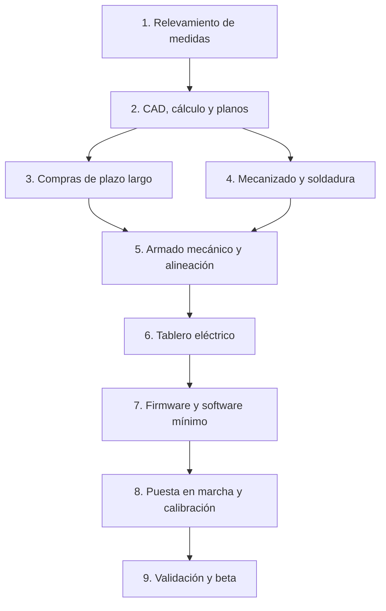

# FlowBench — Plan de fabricación del prototipo

Sep 24, 2026 · @Eric

## Alcance del prototipo

El prototipo 1 de FlowBench es la versión Bici completa: shocks de 40 a 75 mm y horquillas de hasta 200 mm de recorrido y 605 mm de eje a corona, con pantalla propia y SendFlow Lab. Se construye según el plan mecánico del banco; este documento dice qué fabricar, qué comprar y en qué orden.

| Parámetro | Valor |
| --- | --- |
| Fuerza | 10 kN de medición; estructura de 10 kN con sobrecarga a ≈ 8 kN |
| Carreras | 23 posiciones fijas: shocks 40–75 mm, horquillas 100–200 mm |
| Velocidad | ≈ 1,5 m/s en shocks, ≈ 2 m/s en horquillas |
| Accionamiento | Motor trifásico 4 kW, variador de entrada monofásica 220 V, correa 4:1, biela de 300 mm |
| Estructura | Base 550 × 450 mm, columnas Ø 40 × 1.350 mm, puente manual con dos trabas |
| Alto / peso | ≈ 1,6 m / 150 a 190 kg |
| Control | Controlador de tiempo real + computadora con pantalla táctil |

La electrónica y el software todavía no están diseñados en detalle: en esta lista figuran como preliminares, para presupuestar y para no olvidar nada al pedir los componentes con plazo largo.

## Etapas de fabricación

Son nueve etapas, y algunas corren en paralelo. Lo crítico es hacer el CAD antes de mecanizar nada y pedir temprano los componentes con plazo largo. Las duraciones son estimadas, trabajando a tiempo parcial y dependiendo de los proveedores.

| Etapa | Qué se hace | Entregable | Duración estimada |
| --- | --- | --- | --- |
| 1. Relevamiento | Medir largos, carreras, bujes y ejes de shocks Fox y RockShox; tubos de dirección, coronas y ejes de horquillas; curva de palanca de algunos cuadros | Planilla de medidas | 1–2 semanas |
| 2. CAD y cálculo | Modelo 3D completo, verificación por elementos finitos de columnas, puente, biela y base; planos con tolerancias | Planos de fabricación y lista final | 3–6 semanas |
| 3. Compras de plazo largo | Motor, variador, celda, encoder lineal, columnas, bujes de bolas, rodamientos, limitador | Componentes en mano | 2–8 semanas (importados, más) |
| 4. Mecanizado y soldadura | Piezas CNC, base soldada y planeada, tratamientos térmicos | Piezas terminadas | 3–6 semanas |
| 5. Armado mecánico | Base, columnas, carro, puente, cigüeñal, biela, transmisión; alineación con reloj comparador | Máquina mecánica armada | 1–2 semanas |
| 6. Tablero eléctrico | Variador, protecciones, parada de emergencia, enclavamientos, fuentes, cableado de sensores | Tablero probado sin carga | 1–2 semanas |
| 7. Firmware y software mínimo | Adquisición, control del variador, verificación de carrera, gráfico en pantalla | Versión que ensaya y guarda | 3–6 semanas |
| 8. Puesta en marcha | Rodaje en vacío, rigidez, calibración de fuerza, prueba de protecciones | Máquina calibrada | 1–2 semanas |
| 9. Validación y beta | Repetibilidad, shock de referencia, uso real en taller | Informe de validación | 4–8 semanas |

Total estimado: del orden de 5 a 9 meses hasta tener el prototipo validado. Las etapas 3 y 4 pueden ir juntas, y el software puede avanzar mientras se mecaniza.

## Piezas a fabricar

Estas piezas se hacen a medida en talleres de mecanizado, soldadura y tratamiento térmico. Las medidas finales salen del CAD; las de la tabla son de anteproyecto.

| Pieza | Cant. | Material | Proceso | Puntos críticos |
| --- | --- | --- | --- | --- |
| Base | 1 | Chapa 4 mm + tubo 80 × 80 × 3,2 | Plegado, soldadura, granallado, pintura | Planear la placa superior después de soldar |
| Placa superior de base | 1 | Acero F-24, 25 mm | Oxicorte, planeado, agujereado | Planitud; perpendicularidad de los asientos de columnas |
| Placa interna de soportes del cigüeñal | 1 | Acero F-24, 20–25 mm | Mecanizado | Alineación de los dos soportes |
| Eje del cigüeñal | 1 | 4140 bonificado, Ø 40 | Torneado, chavetero, rectificado en asientos | Tolerancia de rodamientos y del limitador |
| Plato de manivela | 1 | 4140 bonificado, Ø 260 × 35 | CNC; 23 agujeros escariados H7 | Posición de agujeros ± 0,02 mm; grabado de carreras |
| Perno de manivela de cambio rápido | 1 (+1 repuesto) | Acero templado y rectificado, Ø 20 | Torneado, templado, rectificado | Asiento cónico; traba de palanca |
| Contrapeso | 1 | Acero | Oxicorte y mecanizado | Balanceo con el plato |
| Biela | 1 | Aluminio 7075-T6 | CNC | Alojamientos de rodamientos H7; distancia entre centros 300 mm |
| Perno del pie de biela | 1 | Acero templado y rectificado | Torneado, templado, rectificado | Sin juego en el carro |
| Carro inferior | 1 | Acero F-24, 25 mm | CNC | Alojamientos de bujes paralelos; asiento de horquilla y adaptador de eje |
| Puente superior | 1 | Acero, 50 × 120 × 420 mm | CNC | Alojamientos de bujes paralelos; asiento del cartucho de sobrecarga |
| Trabas partidas | 2 | Acero + zapatas de bronce | Mecanizado | Superficie de apriete sin marcar el cromo |
| Travesaño superior | 1 | Acero, 25 mm | Mecanizado | Distancia entre columnas igual a la de la base |
| Cartucho de sobrecarga (cuerpo) | 1 | Acero | Torneado | Alojamiento de resortes de disco y fin de carrera |
| Soportes del motor y tensor | 1 juego | Acero | Mecanizado y soldadura | Tensado de correa |
| Soporte del encoder lineal | 1 juego | Aluminio | Mecanizado | Paralelismo con las columnas |
| Brazo de la pantalla | 1 | Aluminio o acero | Mecanizado | Rigidez; fuera de la zona de ensayo |
| Guardas fijas | 1 juego | Chapa perforada | Corte y plegado | Cubren correa, volante y plato |

Tratamientos a cotizar: bonificado del 4140 (o comprarlo ya bonificado), templado de pernos, balanceo dinámico de plato + contrapeso + polea.

## Componentes a comprar: mecánica

Son piezas estándar de catálogo. Los códigos son de referencia para pedir cotización; los definitivos salen del CAD. Costos aproximados en USD, sin cotizar.

| Componente | Cant. | Especificación | Costo aprox. |
| --- | --- | --- | --- |
| Ejes lineales (columnas) | 2 | Ø 40 h6, templados por inducción y cromados, ≈ 1.350 mm | 250 – 400 |
| Bujes de bolas largos para el carro | 2 | Para eje Ø 40, tipo LM40LUU, con juego ajustable o precargados | 80 – 200 |
| Bujes de bolas para el puente | 2 | Para eje Ø 40, tipo LM40UU, con juego ajustable | 40 – 120 |
| Soportes del cigüeñal | 2 | Soporte de pie con rodamiento de rodillos a rótula para eje Ø 40 | 120 – 250 |
| Rodamientos de la cabeza de biela | 1 juego | Rodillos cónicos apareados o agujas con aro interior, para perno Ø 20 | 40 – 100 |
| Rodamiento del pie de biela | 1 | Agujas con aro interior, para perno de pie | 20 – 50 |
| Limitador de torque | 1 | De fricción, para eje Ø 40, regulable ≈ 150–200 N·m | 200 – 350 |
| Resortes de disco (Belleville) | 1 juego | DIN 2093, precarga ≈ 8 kN en pila, según diseño del cartucho | 30 – 80 |
| Resortes a gas del puente | 2 | ≈ 50–80 N cada uno, carrera ≈ 500 mm, con terminales | 40 – 90 |
| Manijas para trabas | 2 | Manija de apriete M16 | 15 – 40 |
| Fuelles de protección | 2–3 | Para columnas y encoder lineal | 30 – 80 |
| Patas niveladoras | 4 | Carga ≥ 100 kg cada una, base de goma dura | 30 – 60 |
| Tornillería de alta resistencia | 1 lote | Clase 10.9 / 12.9, tuercas de columnas M36 | 60 – 120 |
| Materia prima para piezas a fabricar | 1 lote | 4140 bonificado, 7075-T6, F-24, tubo y chapa | incluida en el mecanizado |

## Componentes a comprar: accionamiento y potencia eléctrica

El variador es la compra más delicada: muchos modelos de entrada monofásica llegan solo a 2,2 kW. Antes de comprar, confirmar con el fabricante que el modelo entrega 4 kW con entrada 1 × 220 V y que llega a ≈ 110 Hz.

| Componente | Cant. | Especificación | Costo aprox. |
| --- | --- | --- | --- |
| Motor trifásico | 1 | 4 kW, 4 polos, 1.450 rpm, forma con patas, conexión triángulo 3 × 220 V; confirmar que admite ≈ 3.200 rpm. Marcas con respaldo local, por ejemplo WEG | 300 – 500 |
| Variador de frecuencia | 1 | Vectorial sin sensor, entrada 1 × 220 V, salida 3 × 220 V, 4 kW (o 5,5 kW si hace falta para la entrada monofásica), hasta ≈ 110 Hz, entrada STO, comunicación Modbus o entrada analógica | 300 – 600 (menos si usás uno de los tuyos) |
| Resistencia de frenado | 1 | Según el manual del variador | 40 – 100 |
| Polea motriz | 1 | HTD 8M, 30 mm de ancho, ≈ 22 dientes, buje cónico | 30 – 60 |
| Polea conducida | 1 | HTD 8M, 30 mm, ≈ 88 dientes (4:1), buje cónico | 60 – 120 |
| Correa dentada | 1 (+1 repuesto) | HTD 8M-30, largo según CAD | 30 – 60 |
| Volante | 1 | ≈ 10 kg sobre la polea motriz, o polea motriz con masa agregada | 60 – 120 |
| Interruptor termomagnético y disyuntor diferencial | 1 c/u | Dimensionados según el variador (del orden de 25–40 A con entrada monofásica) | 60 – 120 |
| Toma y ficha industrial | 1 | 2P+T, 32 A | 30 – 60 |
| Cable de potencia y cable blindado de motor | 1 lote | Sección según corriente; cable de motor blindado para reducir ruido eléctrico | 40 – 80 |
| Gabinete eléctrico | 1 | Metálico, con ventilación, riel DIN | 60 – 120 |
| Fuente 24 V | 1 | Riel DIN, ≈ 5 A, para enclavamientos y sensores | 30 – 60 |

La instalación del taller necesita una línea dedicada. El electricista tiene que dimensionarla con el manual del variador elegido.

## Sensores y electrónica (preliminar)

Los sensores de medición se pueden pedir ya, porque su especificación sale del plan mecánico. El resto de la electrónica es preliminar y se cierra en el capítulo de electrónica.

### Sensores

| Componente | Cant. | Especificación | Costo aprox. |
| --- | --- | --- | --- |
| Celda de carga | 1 | 10 kN, tracción–compresión, en línea, apta para fatiga, roscas en ambos extremos, certificado de calibración | 300 – 700 |
| Encoder lineal | 1 | Magnético sin contacto, recorrido ≥ 250 mm, resolución ≤ 1 µm, salida incremental o absoluta | 250 – 600 |
| Encoder del cigüeñal | 1 | Magnético absoluto de eje hueco o con imán en el extremo del eje | 20 – 80 |
| Sensor de posición del perno | 1 juego | Sensores inductivos o Hall codificados, para identificar el agujero del plato | 30 – 80 |
| Sensor de temperatura | 1 | Infrarrojo sin contacto, con salida digital | 15 – 50 |
| Fin de carrera del cartucho de sobrecarga | 1 | Contacto de seguridad | 15 – 40 |

### Electrónica de control (preliminar)

| Componente | Cant. | Especificación | Costo aprox. |
| --- | --- | --- | --- |
| Controlador de tiempo real | 1 | Teensy 4.1 (como en Sender) | 30 – 50 |
| Conversor analógico–digital para la celda | 1 | 24 bits, ≥ 5 kS/s, con amplificador para puente de galgas | 30 – 80 |
| Interfaz con el variador | 1 | Modbus RS-485 o salida analógica 0–10 V aislada | 10 – 40 |
| Computadora de interfaz | 1 | Placa Linux embebida con WiFi y almacenamiento SSD | 100 – 200 |
| Pantalla táctil | 1 | 10 a 15", capacitiva, brillo alto | 100 – 250 |
| PCB de control | 1 | A medida, como en Sender | 30 – 80 |
| Conectores y cableado de señal | 1 lote | Conectores industriales y cable blindado | 50 – 100 |

## Montajes y kits de adaptadores

Para el prototipo alcanza con el kit base (Fox y RockShox) y un kit de horquillas. Öhlins y EXT quedan para después. Las medidas exactas salen del relevamiento de la etapa 1.

| Componente | Cant. | Especificación | Fabricar o comprar | Costo aprox. |
| --- | --- | --- | --- | --- |
| Horquillas de montaje en U | 2 | Aluminio 7075, abertura ≈ 60 mm, ranura en T arriba | Fabricar | 80 – 150 |
| Pernos de ojo | 1 juego | Ø 8 mm h6 (más Ø 6, 10 y pulgadas), templados | Fabricar o comprar | 40 – 80 |
| Separadores de buje | 1 kit | Pares templados para los anchos Fox y RockShox, con tabla por modelo | Fabricar | 150 – 250 |
| Adaptador trunnion | 1 | Bloque con insertos para bulones laterales | Fabricar | 60 – 120 |
| Soporte de dirección | 1 | Collar partido con insertos 1 1/8" y cónico 1,5", colgado de la celda | Fabricar | 100 – 200 |
| Adaptador de eje | 1 | Bujes para 15 × 110 y 20 × 110 Boost, abulonado al carro | Fabricar | 80 – 150 |
| Eje de taller | 1 c/u | 15 × 110 y 20 × 110 | Comprar | 40 – 80 |
| Eslabón rígido de calibración | 1 | Barra maciza con ojos, para medir la rigidez del lazo | Fabricar | 30 – 60 |
| Shocks y horquillas de prueba | 2–3 | Usados, Fox y RockShox, para validar y hacer pruebas destructivas | Comprar usados | según mercado |

Los shocks y horquillas de prueba son importantes: uno sirve como referencia (siempre el mismo, para medir repetibilidad) y otro para provocar topes y probar las protecciones sin arriesgar el de un cliente.

## Gabinete y seguridad

La seguridad se compra completa desde el prototipo: la máquina mueve una biela con 4 kW y ensaya piezas con gas a presión.

| Componente | Cant. | Especificación | Costo aprox. |
| --- | --- | --- | --- |
| Perfil de aluminio ranurado | 1 lote | 40 × 40, para el marco del gabinete de ≈ 1,6 m | 100 – 200 |
| Policarbonato | 1 lote | 8 mm, paneles laterales y puerta | 100 – 200 |
| Bisagras, manija y cierre | 1 juego | Para puerta frontal | 30 – 60 |
| Interruptor de seguridad de puerta | 1 | Con enclavamiento, cableado a la entrada STO del variador | 40 – 100 |
| Parada de emergencia | 1 | Hongo con retención, contactos de seguridad | 20 – 50 |
| Interruptores de tapas laterales | 2 | De seguridad, para acceso a correa y plato | 30 – 60 |
| Relé de seguridad | 1 | Para la cadena de parada de emergencia y puertas | 60 – 150 |
| Bandeja | 1 | Acero inoxidable, bajo la zona de ensayo | 40 – 80 |
| Soplador | 1 | Centrífugo 24 V con control de velocidad | 20 – 50 |
| Luz interior del gabinete | 1 | Tira LED 24 V | 10 – 20 |
| Guardas fijas | 1 juego | Chapa perforada (ver piezas a fabricar) | incluidas arriba |

La cadena de parada de emergencia, las puertas y el cartucho de sobrecarga cortan el variador por hardware. No dependen del software.

## Herramientas para armar y calibrar

No son parte de la máquina, pero sin ellas no se puede alinear ni calibrar. Muchas probablemente ya las tengas.

| Herramienta | Para qué | Costo aprox. si hay que comprarla |
| --- | --- | --- |
| Reloj comparador con base magnética | Paralelismo de columnas, juego del carro y del puente | 40 – 120 |
| Escuadra de precisión y nivel de precisión | Perpendicularidad de columnas y nivelación de la base | 40 – 150 |
| Torquímetro | Trabas, columnas, collar de dirección | 50 – 150 |
| Calibre y micrómetro | Control de piezas mecanizadas | 40 – 120 |
| Pesas patrón o celda de referencia prestada | Calibración de fuerza | según disponibilidad |
| Multímetro y, si es posible, osciloscopio | Cableado de sensores y ruido eléctrico | 40 – 300 |
| Tacómetro óptico | Verificar rpm del motor y del cigüeñal | 20 – 50 |

Para calibrar la celda con precisión conviene pedir prestada o alquilar una celda de referencia certificada, o hacer la calibración en un laboratorio de metrología.

## Orden de compras y riesgos

No conviene comprar todo junto. Primero se hacen el relevamiento y el CAD, después se piden los componentes que definen medidas o tienen plazo largo, y recién entonces se mecaniza.

### Orden sugerido

1. **Antes del CAD:** shocks y horquillas usados de prueba (sirven para el relevamiento). Confirmar si los variadores que ya tenés sirven.
2. **Con el CAD avanzado:** motor, variador, celda de carga, encoder lineal, columnas y bujes de bolas. Son los de plazo más largo y sus medidas definen piezas mecanizadas.
3. **Con los planos cerrados:** rodamientos, limitador, poleas, correa, resortes de disco y a gas; enviar piezas a mecanizar.
4. **Durante el mecanizado:** gabinete, seguridad, tablero eléctrico, electrónica y pantalla.
5. **Al final:** kits de adaptadores, ajustados con los shocks y horquillas reales.

### Riesgos

| Riesgo | Consecuencia | Cómo reducirlo |
| --- | --- | --- |
| Variador monofásico que no entrega 4 kW | Falta torque en horquillas largas | Confirmar el modelo antes de comprar; plan B: motor 2,2 kW con correa 5:1 y menos velocidad |
| Motor que no admite ≈ 3.200 rpm | Menos velocidad en shocks cortos | Consultar al fabricante; plan B: relación 3:1 con menos torque |
| Columnas de 1,35 m que flexionan | Error de medición | Verificar en el CAD; plan B: columnas Ø 50 |
| Juego en bujes de bolas estándar | Picos falsos en la inversión | Usar bujes con juego ajustable o precargados |
| Plazos de importación de celda y encoder | Demora | Pedirlos primero; buscar proveedores locales |
| Mecanizado fuera de tolerancia | Juego o desalineación | Planos con tolerancias claras; controlar cada pieza al recibirla |
| Fuerza de horquillas cerca del fondo mayor que la prevista | Curva de resorte incompleta | Medir en la etapa 1; si hace falta, relación 5:1 |

## Resumen de costos

El prototipo completo, con electrónica y pantalla, sale aproximadamente entre USD 5.500 y 11.400. Son sumas de rangos no cotizados: el número real sale de los presupuestos locales.

| Grupo | Costo aprox. (USD) |
| --- | --- |
| Piezas a fabricar (mecanizado, soldadura, materia prima, tratamientos) | 1.500 – 3.000 (a cotizar con los planos) |
| Mecánica comprada | 950 – 1.950 |
| Accionamiento y potencia eléctrica | 1.050 – 2.000 |
| Sensores | 650 – 1.550 |
| Electrónica de control y pantalla (preliminar) | 350 – 800 |
| Montajes y kits | 600 – 1.100 |
| Gabinete y seguridad | 450 – 1.000 |
| **Total sin herramientas** | **≈ 5.500 – 11.400** |
| Herramientas de armado y calibración (si no las tenés) | 0 – 900 |

El rango es más amplio que el del plan mecánico (USD 5.400 a 8.900) porque ahora incluye la electrónica, la pantalla, el tablero eléctrico y la seguridad completa. Donde más se puede ahorrar: usar tus propios variadores, conseguir celda y encoder a buen precio y negociar el mecanizado con un solo taller.

No incluye mano de obra propia, horas de diseño ni los shocks y horquillas usados de prueba.
